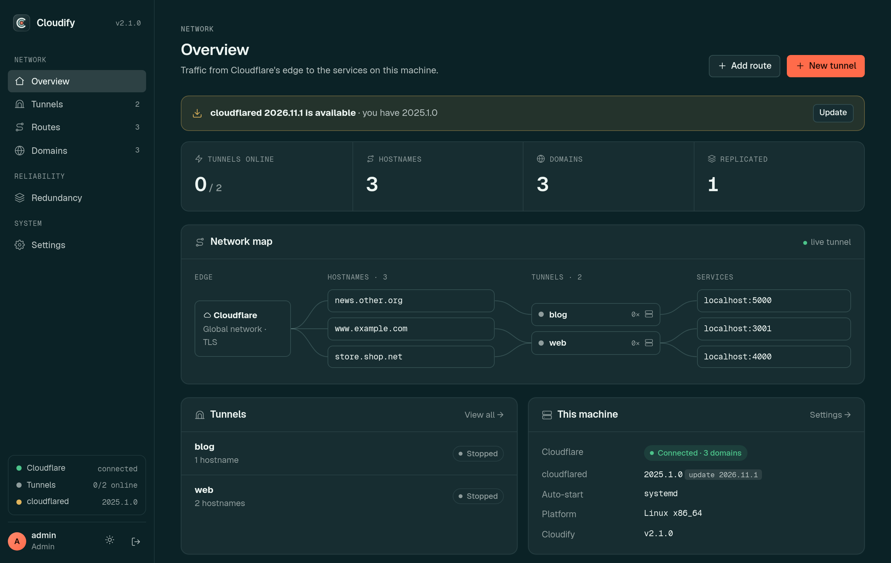
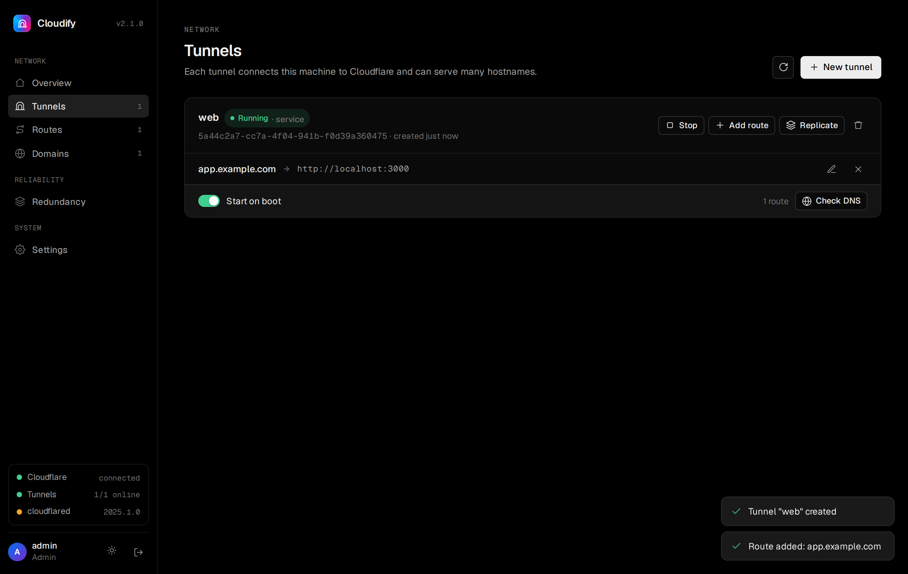
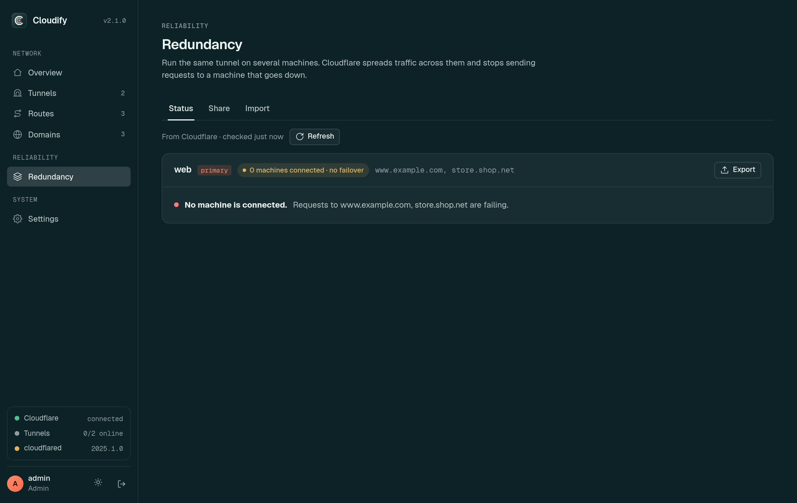

# Cloudify 
**Tunnel management with ease**

Cloudify lets you manage tunnel services in one go. You can expose your routes and maintain them with ease. Built upon Cloudflare services, you get robust tunnels with security, all running locally on your platform with no third-party dependencies except for cloudflared.

✨ **Key Features:**
- Local tunnel management with Cloudflare's robust infrastructure
- Load balancing support
- CLI and a built-in web dashboard (light/dark, mobile friendly)
- Cross-platform support (Linux, macOS, Windows, Docker)
- Auto-restart functionality for tunnels
- Directly Use on AWS,AZURE and GCP

## 📖 Documentation

Detailed guides are in [`docs/`](docs/README.md):
[Getting started](docs/getting-started.md) ·
[Linux](docs/install-linux.md) · [macOS](docs/install-macos.md) · [Docker](docs/docker.md) · [Windows](docs/install-windows.md) ·
[Updating](docs/updating.md) · [Dashboard](docs/dashboard.md) · [CLI reference](docs/cli-reference.md) ·
[SSH sharing](docs/ssh.md) · [Files and backups](docs/files-and-data.md) · [Troubleshooting](docs/troubleshooting.md) ·
[Security](docs/security.md)

## 📋 Table of Contents

- [Prerequisites](#-prerequisites)
- [Installation](#-installation)
  - [Linux/macOS](#linux-and-macos)
  - [Windows](#windows)
  - [Docker](#docker)
- [Initial Setup](#-initial-setup)
- [Quick Start](#quick-tunnel-no-setup-required)
- [Web Dashboard](#-web-dashboard)
- [CLI Usage](#-cli-usage)
  - [Basic Commands](#basic-commands)
  - [Tunnel Management](#tunnel-management)
  - [Route Management](#route-management)
- [Docker Usage](#-docker-usage)
- [Examples](#-examples)
- [Development](#-development)
- [Contributing](#-contributing)
- [Support](#-support)
- [License](#-license)

## 📋 Prerequisites 

You can just install and run a temporary tunnel using [Quick Tunnel](#quick-tunnel-no-setup-required) for full functionalities
these are the requirements:

1. **Domain** - A domain name for your tunnels
2. **Cloudflare Account** - With your domain added for full functionality

### Cloudflare Setup

Set up your Cloudflare account and add your domain:
👉 [Cloudflare Domain Setup Guide](https://developers.cloudflare.com/fundamentals/manage-domains/add-site/)

## 🚀 Installation

We've made installation easy across most operating systems and environments.

### Linux and macOS

One script for both. It installs what's missing (Python, pipx, git, cloudflared) and Cloudify itself,
asks no questions, and can be run again to update:

```bash
curl -fsSL https://raw.githubusercontent.com/yash7158/Cloudify_v2/main/install.sh | bash
```

Options (pass them after `bash -s --`, e.g. `curl ... | bash -s -- --branch dev`):

| Option | |
| --- | --- |
| `--update` | update an existing installation, also from Cloudify 1.x (keeps tunnels, settings and users) |
| `--branch NAME` | install a specific branch or tag |
| `--local DIR` | install from a local checkout: `bash install.sh --local .` |
| `--skip-cloudflared` | don't install or update cloudflared |
| `--uninstall` / `--purge` | remove Cloudify (`--purge` also deletes its accounts and settings) |
| `--verbose` | show every command's output |

Supported: Debian/Ubuntu, Fedora/RHEL, Arch, openSUSE, Alpine (apt, dnf/yum, pacman, zypper, apk) and macOS
with Homebrew. Cloudify needs **Python 3.8 or newer**; the installer installs it when missing (also next to an
older system Python, e.g. on RHEL/Rocky 8). `sudo` is used only for system packages and `/usr/local/bin`; without it cloudflared is
installed to `~/.local/bin`. Open a new terminal afterwards if `cloudify` isn't found yet.

(The old `install_scripts/final.sh` and `install_scripts/mac.sh` links still work; they run `install.sh`.)

**Updating** (any earlier version, including 1.x installed with the old scripts):

```bash
curl -fsSL https://raw.githubusercontent.com/yash7158/Cloudify_v2/main/install.sh | bash -s -- --update
```

It backs up your settings, replaces the program, moves 1.x dashboard accounts and leaves running tunnels
alone. Details: [docs/updating.md](docs/updating.md). Step-by-step guides for each system:
[Linux](docs/install-linux.md), [macOS](docs/install-macos.md).

### Windows

Use WSL 2 with the Linux installer above, or Docker Desktop with the Docker setup below. A native
installation with pipx also works (experimental). All three are described in
[docs/install-windows.md](docs/install-windows.md).

### Docker

Everything Docker-related is in [`docker/`](docker/README.md):

```bash
git clone https://github.com/yash7158/Cloudify_v2.git && cd Cloudify_v2
docker compose -f docker/docker-compose.yml up -d --build  # build + run, restarts after reboot
# or without compose:
docker build -f docker/Dockerfile -t cloudify:latest .
docker run -d --restart unless-stopped -p 127.0.0.1:8765:8765 -v cloudify-data:/root/.cloudflared \
  --name cloudify cloudify:latest

# to get the setup code
docker logs cloudify
```

Full guide (networks, updating, moving from the 1.x container, backups, NAS and Raspberry Pi):
[docs/docker.md](docs/docker.md).

## ⚙️ Initial Setup

After successful installation, the `cloudify` CLI tool will be available.

### Quick Tunnel (No Setup Required)

For a quick temporary tunnel without any configuration:

```bash
cloudify -p <port>
```

This automatically starts a temporary tunnel on the specified port and prints a random
`https://<words>.trycloudflare.com` URL. (Quick tunnels can't use a custom subdomain;
use a named tunnel and `cloudify route add` for your own domain.)

### Keeping cloudflared up to date

```bash
cloudify cloudflared version   # installed vs latest release
cloudify cloudflared update    # self-update (or prints the brew/apt command to use)
```

Re-running the install script also updates cloudflared to the latest release.

## 🖥️ Web Dashboard

Start the dashboard (same command on Linux, macOS and Windows; no Node.js needed):

```bash
cloudify serve                 # http://localhost:8765
cloudify serve --serve-port 9000
cloudify serve --host 0.0.0.0 --ssl-certfile cert.pem --ssl-keyfile key.pem   # HTTPS for other devices
```



| Tunnels | Redundancy status |
| --- | --- |
|  |  |

### First run

1. **Create your account** with the setup code that `cloudify serve` printed (`docker logs cloudify` in
   Docker). Only the first account can be created without signing in, and only with that code.
   Add more people later under **Settings → Users**. Accounts are stored in
   `~/.cloudflared/cloudify/users.json`.
2. **Connect Cloudflare.** Click *Connect Cloudflare*, open the link and authorize your domain
   (this runs `cloudflared tunnel login` for you). You can skip and do it later.
3. **Create a tunnel and add routes.**

### What you can do

| Page | Features |
| --- | --- |
| **Overview** | Live network map (Cloudflare → hostnames → tunnels → services), counts, cloudflared update notice |
| **Tunnels** | Create, start/stop, delete, toggle *Start on boot*, add/edit/remove routes, adopt tunnels created outside Cloudify |
| **Routes** | All hostnames grouped by domain, with search and a domain filter |
| **Domains** | Connect any number of domains (one or several Cloudflare accounts), automatic DNS cleanup |
| **Redundancy** | Live status of every machine serving a tunnel; share (export) and import replicas |
| **Settings** | Change password, add/remove users, connect Cloudflare, update cloudflared, stop the server |

Routes take a public hostname (`app.example.com` or `*.example.com`), a service host
(`localhost`, an IP, or a Docker container name) and a port. `http://` is added for you.
Light and dark themes are included, and the layout works on phones.

By default the dashboard only listens on this machine (`127.0.0.1`). To use it from other devices, prefer
an SSH tunnel (`ssh -L 8765:localhost:8765 server`), HTTPS (`--ssl-certfile/--ssl-keyfile`), or a tunnel route
protected by Cloudflare Access; plain HTTP on the network needs `--insecure-http`. See
[docs/security.md](docs/security.md). Interactive API docs: start with `--api-docs`, then open `/api/docs`.

## 🌐 Multiple Domains and Cloudflare Accounts

Each Cloudflare login authorizes **one domain**. Connect as many as you need, including domains in
other Cloudflare accounts (dashboard: **Domains → Connect domain**):

```bash
cloudify account connect example.com     # opens the Cloudflare authorization link
cloudify account connect shop.net        # same or another Cloudflare account
cloudify account list
```

* A tunnel belongs to one Cloudflare account and can serve hostnames on **any domain of that account**
  (e.g. `app.example.com` and `store.shop.net` on the same tunnel).
* When several accounts are connected, choose one when creating a tunnel:
  `cloudify tunnel create web --account shop.net` (an account ID or any of its domains).
* Cloudify always creates DNS records with the right domain's certificate.
* Installs from older versions keep working: the existing `~/.cloudflared/cert.pem` becomes the
  first connection (name its domain with `cloudify account domain default example.com`).

## ✏️ Editing Routes

Change a route's subdomain, local address or port after creating it (dashboard: pencil icon):

```bash
cloudify route edit app.example.com --port 3001
cloudify route edit app.example.com --service my_container --port 80
cloudify route edit app.example.com --hostname www.example.com   # creates the new DNS record
```

When the hostname changes, the old hostname's DNS record is deleted if automatic DNS cleanup is
on for its domain (see below); otherwise remove it in the Cloudflare dashboard.

## 🧹 DNS Records

Adding a route creates a `CNAME` record pointing at `<tunnel-id>.cfargotunnel.com`.
cloudflared can create DNS records but **cannot delete them**, so by default removing a route,
renaming its hostname or deleting a tunnel leaves the record in Cloudflare.

Turn on **automatic DNS cleanup** per domain with a Cloudflare API token. To create one:

1. Open [dash.cloudflare.com → My Profile → API Tokens](https://dash.cloudflare.com/profile/api-tokens)
   and click **Create Token**.
2. Next to **Edit zone DNS**, click **Use template**.
3. Permissions: keep `Zone · DNS · Edit` (nothing else is needed).
4. Zone Resources: `Include · Specific zone · <your domain>`.
5. Optional: restrict *Client IP Address Filtering* to this server's IP and set a TTL.
6. **Continue to summary → Create Token**, and copy it (Cloudflare shows it only once).
7. Add it to Cloudify (it is checked with Cloudflare before it is saved):

* Dashboard: **Domains → DNS cleanup** next to the domain
* CLI: `cloudify account token <connection-id>` (see `cloudify account list`)

Cloudify then deletes a hostname's record when you remove its route, rename it or delete its tunnel.
It only ever deletes a `CNAME` that points at **that exact tunnel**; records you have pointed
elsewhere are left alone, and removing a *replica* never touches DNS.

**When cleanup happens:** removing a route, renaming a route's hostname (the old name's record),
and deleting a tunnel (after Cloudflare confirms the deletion). Never when stopping a tunnel,
removing a replica, disconnecting a domain, or splitting hostnames into a new tunnel (their records
are re-pointed instead).

**Replicas share DNS:** there is one record per hostname and it points at the *tunnel*, so deleting it
takes the hostname offline on every machine running that tunnel. When you remove a route from a
replicated tunnel, export it again so the other machines drop the route too.

**Records deleted by accident** (e.g. in the Cloudflare dashboard) take the hostname offline even though
the tunnel stays healthy. Check and repair them:

* Dashboard: **Tunnels → Check DNS**, then **Recreate** (or **Re-point** for a record pointing elsewhere)
* CLI: `cloudify route check -t web` and `cloudify route repair app.example.com -t web [--overwrite]`

With an API token the check is exact; without one it uses a public DNS lookup (detects missing
records). Repair uses cloudflared and works without a token. The token is stored in
`~/.cloudflared/cloudify/accounts.json` (readable only by you) and never shown in the UI.

## 🔁 Redundancy: run the same tunnel on several machines

Cloudflare tunnels support **replicas**: when the same tunnel runs on several machines, Cloudflare
spreads requests across them and automatically stops sending traffic to a machine that goes down.
No load balancer or DNS change is needed.

**Dashboard:** *Redundancy → Share from this machine*: pick whole tunnels, whole domains or single
subdomains, set a passphrase and download the file. On the other machine: *Redundancy → Import*.

**CLI:**

```bash
# machine A
cloudify replica export web.json -t web            # asks for a passphrase
# machine B (needs no Cloudflare login)
cloudify replica import web.json
```

* Every machine running a tunnel serves **all** of its hostnames. To make only some hostnames
  redundant, Cloudify first moves them into their own tunnel (DNS is re-pointed, no downtime):
  `cloudify replica split web store.shop.net --name web-ha`, then export `web-ha`.
  (`cloudify replica plan -H store.shop.net` shows what is needed.)
* The file contains the tunnel's secret and is encrypted (scrypt + AES-256-GCM). Keep the passphrase safe.
* The other machine needs the same services running (e.g. something on `localhost:3000`).
* Routes of a replica are managed on the original machine. After changing them, export again and
  import the new file on the other machines (the dashboard warns when replicas are outdated).
* **Redundancy → Status** is a live dashboard (refreshes every 10 s) of every machine connected
  to Cloudflare for each shared tunnel: IP, edge connections (healthy = 4/4), Cloudflare data
  centers, cloudflared version and uptime, with "this machine" marked. Seeing *all* machines needs
  the tunnel's Cloudflare domain connected on that machine; a replica without one still shows its
  own connection health (from cloudflared's local `/ready` endpoint).
* A tunnel can only be deleted once its replicas are removed; removing a replica never affects
  the other machines.

## 🔐 Temporary SSH access

Share a shell on this machine with someone else, with no open ports, no firewall changes and no
Cloudflare account. It goes through a temporary Cloudflare tunnel:

```bash
# machine A: prints an access code, a password and a one-line command (Ctrl+C stops sharing)
cloudify -ssh host                 # --once, --ttl 15, --save-code code.txt

# machine B: asks for the access code and the password, then opens a shell
cloudify -ssh remote               # -- uptime   (one command)   --sftp   (file transfer)
# ...or paste the one-line command the host printed:
cloudify -ssh remote --code cfyssh1.... --password xxxx-xxxx-xxxx-xxxx
```

* Fresh keys and password for every session; the host only accepts the session key (never passwords),
  the host key is pinned, and the code is encrypted with the password. Send the code and the password
  separately.
* The remote gets a shell **as the user who ran `cloudify -ssh host`**. Several remotes can be
  connected at once. Ctrl+C stops sharing immediately (all remotes are disconnected); so do `--ttl`
  (default 60 min) and `--once`.
* The host always prints the one-line command too (it contains the code and the password); using it
  or typing the two values is up to you. Typing them, sent over separate channels, is safer: whoever
  sees the one-line command can connect.
* Needs `cloudflared` on both machines and the OpenSSH client (`ssh`) on the remote.

Details, security model and code layout: [`cloudify/ssh/README.md`](cloudify/ssh/README.md).

## 🛡️ Safety check: see and stop everything

`safety-check.sh` shows everything on a machine that is reachable through Cloudflare, and can stop it or
remove Cloudify completely. It needs only bash, so it also works where Cloudify isn't installed (or was
already removed), and it changes nothing unless you ask:

```bash
curl -fsSL https://raw.githubusercontent.com/yash7158/Cloudify_v2/main/safety-check.sh | bash                          # list (changes nothing)
curl -fsSL https://raw.githubusercontent.com/yash7158/Cloudify_v2/main/safety-check.sh | bash -s -- --kill             # stop temporary tunnels and SSH sharing
curl -fsSL https://raw.githubusercontent.com/yash7158/Cloudify_v2/main/safety-check.sh | bash -s -- --kill-all         # also persistent tunnels and the dashboard (asks first)
curl -fsSL https://raw.githubusercontent.com/yash7158/Cloudify_v2/main/safety-check.sh | bash -s -- --remove           # uninstall Cloudify and cloudflared, remove auto-start (asks first)
curl -fsSL https://raw.githubusercontent.com/yash7158/Cloudify_v2/main/safety-check.sh | bash -s -- --remove --purge   # ...and delete ~/.cloudflared (certificates, tunnel keys)
```

It lists:

* temporary tunnels, with their public `trycloudflare.com` address and the local service behind them;
* SSH sharing sessions, and the programs that remotes are running;
* outgoing SSH sessions;
* persistent tunnels, and what keeps them running (systemd, launchd, cron, Docker);
* the dashboard, and whether the network can reach it;
* what starts at boot, and what is installed.

Tunnel tokens are never shown. From a checkout, run `bash safety-check.sh [--kill | --kill-all | --remove [--purge]]`.
Details: [docs/security.md](docs/security.md#safety-check).

## 💻 CLI Usage

### Basic Commands

View all available commands:

```bash
cloudify
```

Initial setup (required for CLI usage):

```bash
cloudify setup
```

### Tunnel Management

**List all tunnel commands:**

```bash
cloudify tunnel
```

**Create a new tunnel:**

```bash
cloudify tunnel create <tunnel_name>
```

**Delete a tunnel:**

```bash
cloudify tunnel delete <tunnel_name>
```

### Route Management

**Add a route:**

```bash
cloudify route add <domain> <port>
```

**View route options:**

```bash
cloudify route add --help
```

**Remove a route:**

```bash
cloudify route remove <subdomain.domain.com>
```

## 🐳 Docker Usage

### Docker Compose (recommended)

```bash
docker compose -f docker/docker-compose.yml up -d --build
docker logs cloudify # to get the setup code
```

The compose file sets `restart: unless-stopped`, so after a server reboot (or a crash) the
container starts again and every tunnel with auto-start enabled is started inside it.

> **Why not in the image?** Docker restart policies belong to the container, not the image,
> so they must be set with `restart:` in compose or `--restart` on `docker run`. Also make
> sure Docker itself starts at boot: `sudo systemctl enable docker` (the default on most Linux
> distributions).

### Basic Docker Setup

```bash
docker build -f docker/Dockerfile -t cloudify:latest .
docker run -d --restart unless-stopped -p 127.0.0.1:8765:8765 -v cloudify-data:/root/.cloudflared --name cloudify cloudify:latest
```

The `cloudify-data` volume keeps your Cloudflare login, tunnel credentials, configs and
Cloudify accounts when the container is re-created.

### Docker Network Setup (Recommended)

For accessing services outside the container, create a Docker network:

```bash
# Create network
docker network create my-net

# Run Cloudify with network
docker run -d --restart unless-stopped -p 127.0.0.1:8765:8765 -v cloudify-data:/root/.cloudflared --name cloudify --network my-net cloudify:latest

# Run your service container on the same network
docker run -d --restart unless-stopped --name frontend --network my-net <your-image>
```

Access the UI at `localhost:8765` and configure:

* **End User URL:** `frontend` (container name)
* **Port:** `3000` (or your service port)

## 📚 Examples

### Example 1: Exposing a Frontend Service

**Scenario:** Frontend running on port 3000

**Frontend Method:**

1. Create tunnel with desired name
2. Add route:

   * Subdomain: `app.mydomain.com`
   * End Route: `localhost`
   * Port: `3000`

**CLI Method:**

```bash
cloudify tunnel create my-frontend
cloudify route add app.mydomain.com 3000
```

### Example 2: Docker Multi-Service Setup

```bash
# Create network
docker network create app-network

# Start Cloudify
docker run -d --restart unless-stopped -p 127.0.0.1:8765:8765 -v cloudify-data:/root/.cloudflared --name cloudify --network app-network cloudify:latest

# Start frontend service
docker run -d --restart unless-stopped --name frontend --network app-network -p 3000:3000 my-frontend-image

# Start backend service  
docker run -d --restart unless-stopped --name backend --network app-network -p 8000:8000 my-backend-image
```

Then configure routes in the UI:

* Frontend: `frontend:3000` → `app.mydomain.com`
* Backend: `backend:8000` → `api.mydomain.com`

## 🛠️ Development

Requires Python 3.8 or newer (tested on 3.8 to 3.14).

```
cloudify/
  cli.py          command line
  core/           tunnel logic shared by CLI and server
    manager.py      TunnelManager (create, routes, start/stop, delete, quick tunnels)
    autostart.py    systemd --user / cron / launchd / Windows Task Scheduler backends
    cloudflared.py  wrapper around the cloudflared binary (+ version/update)
    processes.py    find/start/stop tunnel processes on every OS
    state.py, login.py, validation.py, paths.py
  server/         FastAPI app, auth (users/tokens), API routes
  web/            the dashboard (plain HTML/CSS/JS modules, no build step)
  ssh/            temporary SSH sharing (cloudify -ssh host|remote), see cloudify/ssh/README.md
docker/           Dockerfile, entrypoint, compose file
docs/             user documentation
install.sh        installer/updater for Linux and macOS
safety-check.sh   lists and stops everything reachable through Cloudflare; removes Cloudify (needs only bash)
tests/            pytest suite; tests/fakes/ has a fake cloudflared, systemctl and crontab
```

```bash
pip install -e ".[test]"
pytest                                   # CLI, API and unit tests (no Cloudflare account needed)
pip install playwright && playwright install chromium
pytest tests/test_ui.py                  # browser test of the whole dashboard
CLOUDIFY_REAL_CLOUDFLARED=$(which cloudflared) pytest tests/test_quick_tunnel.py  # real quick tunnel
CLOUDIFY_DOCKER_TESTS=1 pytest tests/test_docker.py   # builds the image, tests restart/upgrade
CLOUDIFY_INSTALL_TESTS=1 pytest tests/test_install.py # install.sh on 7 distributions, updates from 1.x, safety-check.sh (Docker)
```

The tests use fakes for `cloudflared`, `systemctl`, `crontab` and `loginctl`, so they never touch
your Cloudflare account, services or crontab.

## 🤝 Contributing

Contributions are welcome! Please run the test suite before opening a pull request.

## 💖 Support

If you find this project helpful, consider supporting its development:

[](https://buymeacoffee.com/vickydev810)

## 📄 License

MIT, see [LICENSE](LICENSE).
